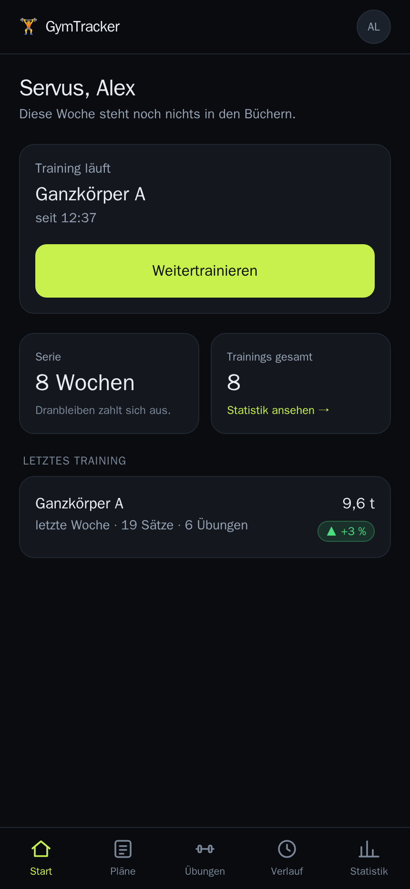
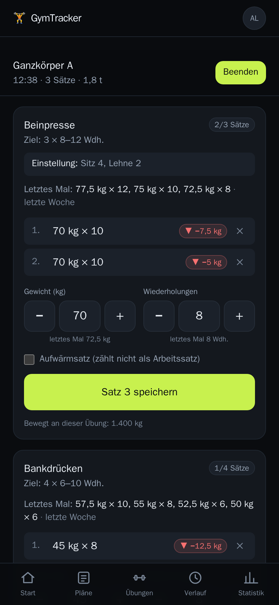
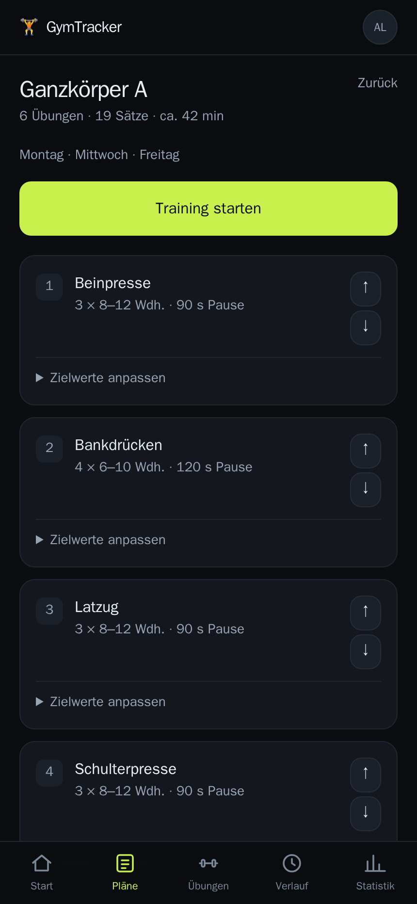
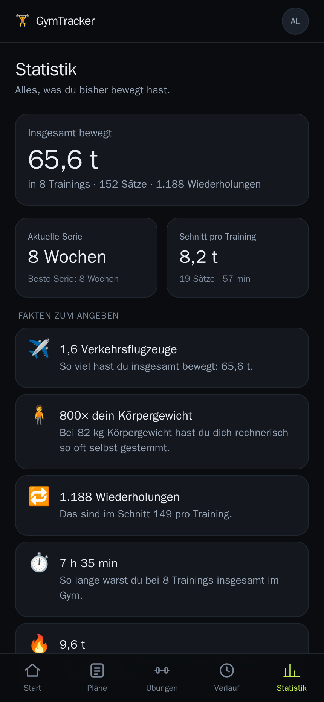
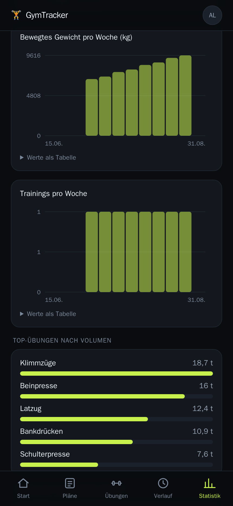
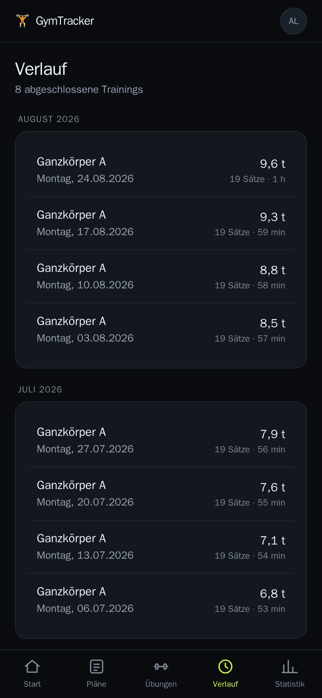

# GymTracker

[](https://github.com/pvillmann/gymtracker/actions/workflows/docker.yml)

Selbst gehosteter Tracker fürs Gym, gebaut fürs Handy: Sätze mitschreiben und
sehen, was letztes Mal an derselben Maschine stand – dazu Essen, Gewicht und
ein Wochenrückblick. Ein Container, eine SQLite-Datei, keine Cloud.

| | |
| --- | --- |
| 📱 **Training** | Satz für Satz mitschreiben, Vergleich zum letzten Mal, Pausentimer mit Push, Vorschlag fürs nächste Gewicht |
| 🏋️ **Pläne & Maschinen** | Pläne mit Zielwerten, gemeinsamer Maschinenkatalog mit Fotos und Studios, Pläne per Link teilen |
| 🍽️ **Essen** | Mahlzeiten per Foto im Claude-Chat oder von Hand; Eiweiß- und Kalorienziel aus Regeln |
| ⚖️ **Körper** | Bluetooth-Waage direkt im Browser, Gewichtstrend, Körperfett-Schätzung, Apple-Health-Import |
| 📈 **Fortschritt** | 1RM-Verlauf, Rekorde, Sätze pro Muskelgruppe, Wochenrückblick |
| 💬 **Claude** | Eigener MCP-Server („Latzug 20 kg, 12 Wdh.“ wird zum Satz); optional Claude Haiku mit eigenem API-Schlüssel |

Mehr dazu: **[Alle Funktionen](docs/funktionen.md)** ·
[Claude/MCP](docs/claude-mcp.md) · [Waage & Apple Health](docs/koerper.md) ·
[Betrieb & Sicherheit](docs/betrieb.md) · [Entwicklung](docs/entwicklung.md)

## Screenshots

## Screenshots

<table>
  <tr>
    <td width="33%"><br />Start</td>
    <td width="33%"><br />Training mitschreiben</td>
    <td width="33%"><br />Trainingsplan</td>
  </tr>
  <tr>
    <td width="33%"><br />Statistik &amp; Fun Facts</td>
    <td width="33%"><br />Verlaufscharts</td>
    <td width="33%"><br />Verlauf</td>
  </tr>
</table>

## Schnellstart

Das Image wird bei jedem Push auf `main` gebaut und liegt öffentlich unter
`ghcr.io/pvillmann/gymtracker:latest`. SMTP ist Pflicht – ohne Bestätigungsmail
kommt niemand ins Konto.

```bash
docker run -d --name gymtracker --restart unless-stopped \
  -p 3000:3000 -v gymtracker-data:/data \
  -e SMTP_HOST=smtp.example.com -e SMTP_PORT=587 \
  -e SMTP_USER=dein-nutzername -e SMTP_PASSWORD=dein-passwort \
  -e SMTP_FROM="GymTracker <noreply@example.com>" \
  -e APP_URL=http://<dein-server>:3000 \
  ghcr.io/pvillmann/gymtracker:latest
```

Oder mit Compose: Repo klonen, Werte in `docker-compose.yml` eintragen,
`docker compose up -d`.

**Erster Login:** Solange es keinen Administrator gibt, schreibt GymTracker
bei jedem Start ein Einrichtungskonto ins Log:

```bash
docker logs gymtracker 2>&1 | grep -A6 "nicht eingerichtet"
```

Damit anmelden, eigenes Konto anlegen – es wird Administrator, das
Einrichtungskonto verschwindet. Details: [Ersteinrichtung](docs/betrieb.md#ersteinrichtung).

**Aus dem Internet erreichbar?** HTTPS davor (Reverse Proxy) und
`REGISTRATION_CODE` setzen – siehe [Betrieb](docs/betrieb.md#hinter-einem-reverse-proxy).

## Konfiguration

| Variable | Standard | Bedeutung |
| --- | --- | --- |
| `DATABASE_PATH` | `./data/gym.db` lokal, `/data/gym.db` im Container | Pfad zur SQLite-Datei. Im Container von `docker-compose.yml` gesetzt – trag ihn nicht zusätzlich in die `.env` ein. |
| `REGISTRATION_CODE` | — | Wenn gesetzt, ist die Registrierung durch diesen Code geschützt |
| `COOKIE_SECURE` | automatisch | Erzwingt (`true`) oder verhindert (`false`) das `secure`-Flag des Session-Cookies |
| `SMTP_HOST` | — | Pflicht. Adresse des SMTP-Servers |
| `SMTP_PORT` | `587` | SMTP-Port |
| `SMTP_USER` / `SMTP_PASSWORD` | — | SMTP-Zugangsdaten |
| `SMTP_FROM` | — | Pflicht. Absender inkl. Anzeigename, z. B. `GymTracker <noreply@example.com>` |
| `SMTP_SECURE` | automatisch (Port 465) | Erzwingt implizites TLS unabhängig vom Port |
| `APP_URL` | — | Pflicht. Basis-URL für Links in Mails, ohne `/` am Ende |
| `DB_BACKUP_BEFORE_MIGRATION` | `true` | Vor ausstehenden Migrationen eine Kopie nach `backups/` neben der Datenbank schreiben |
| `TZ` | Systemzeitzone | Bestimmt, wann eine Trainingswoche beginnt |
| `PORT` | `3000` | Port des Servers |
| `PUSH_EXTRA_HOSTS` | — | Weitere erlaubte Hosts für Push-Endpunkte, kommagetrennt (z. B. ein eigener Push-Dienst). Standard sind nur die Dienste von Google, Mozilla, Microsoft und Apple |
| `SECRET_KEY` | Datei `secret.key` neben der Datenbank | Schlüssel für gespeicherte API-Schlüssel, mindestens 32 Zeichen (z. B. `openssl rand -base64 32`). Nachträglich ändern macht gespeicherte Schlüssel unlesbar |

## Update und Backup

```bash
docker compose pull && docker compose up -d
```

Migrationen laufen beim Start; davor legt GymTracker eine Kopie der Datenbank
unter `/data/backups/` an. Für ein echtes Backup `/data/gym.db` und
`/data/secret.key` sichern – getrennt voneinander. Wie das im laufenden
Betrieb sauber geht: [Backup](docs/betrieb.md#backup).

## Technik

Next.js 16 und React 19, SQLite mit Drizzle, Tailwind 4, eigene Auth,
MCP über das offizielle SDK. Lokal starten: `npm install && npm run db:migrate && npm run dev` –
mehr unter [Entwicklung](docs/entwicklung.md).
